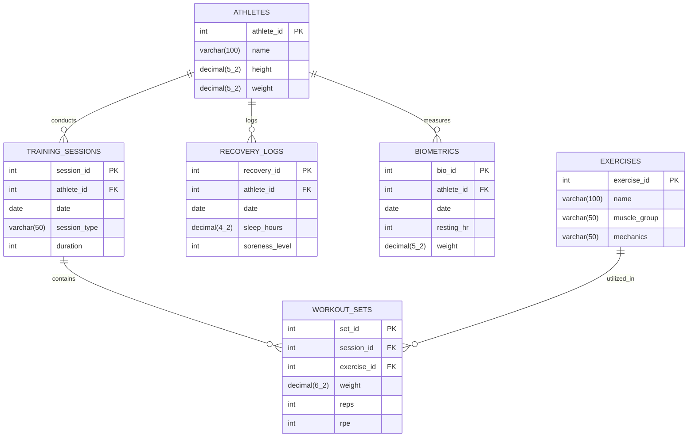

# ⚡ AthletIQ — Intelligent Athletic Performance Tracker

[](https://www.python.org/)
[](https://flask.palletsprojects.com/)
[](https://www.postgresql.org/)
[](https://www.psycopg.org/)
[](LICENSE)

An end-to-end, full-stack athletic performance, strength training, and recovery monitoring platform built with **Flask** and **PostgreSQL**. Engineered with pure parameterized SQL queries via `psycopg2` (zero ORM overhead) for raw performance, relational data integrity, and deep analytical insight.

---

## 📖 Table of Contents

- [Overview](#-overview)
- [Core Features](#-core-features)
- [Database Schema & Architecture](#-database-schema--architecture)
- [Tech Stack](#-tech-stack)
- [Project Structure](#-project-structure)
- [Getting Started](#-getting-started)
  - [Prerequisites](#prerequisites)
  - [Installation & Setup](#installation--setup)
  - [Database Initialization & Seeding](#database-initialization--seeding)
  - [Running the Application](#running-the-application)
- [Application Routes](#-application-routes)
- [Database Design Highlights](#-database-design-highlights)
- [Contributing & License](#-contributing--license)

---

## 🌟 Overview

AthletIQ bridges the gap between raw biometric signals and high-performance training regimens. It allows coaches, sports scientists, and athletes to track:
1. **Training Volume & Intensity**: Weight, reps, and Rate of Perceived Exertion (RPE 1–10).
2. **Session Progression**: Compound and isolation movements across muscle groups.
3. **Recovery & Biomarkers**: Sleep duration, perceived muscle soreness, resting heart rate, and bodyweight fluctuation.
4. **Relational Analytics**: Complex SQL queries combining sessions, athletes, exercises, and sets in real time.

---

## 🚀 Core Features

- 📊 **Dynamic Analytics Dashboard**:
  - Top-line KPI summary cards: Total Sets Logged, Cumulative Volume Load ($\sum \text{weight} \times \text{reps}$), Average RPE, and Active Athlete Roster.
  - Live activity feed powered by a real-time 4-table relational `JOIN` (`WorkoutSets` $\bowtie$ `TrainingSessions` $\bowtie$ `Athletes` $\bowtie$ `Exercises`).
- 🏋️ **Athlete Roster Management**:
  - Full CRUD operations to create, view, edit, and manage athlete profiles including height, weight, and biometric identifiers.
- 📋 **Exercise Catalog**:
  - Exercise directory categorized by primary muscle group (*Legs, Back, Chest, Shoulders, Arms, Core*) and biomechanical movement pattern (*Compound* vs. *Isolation*).
- ⚡ **Granular Workout Logging**:
  - Fast workout entry allowing coaches and athletes to log sets against existing training sessions with live calculation of individual volume load.
- 📅 **Session Aggregations**:
  - Consolidated view of training sessions grouped by date and athlete with total session duration, set count, and cumulative tonnage lifted.
- 🛌 **Recovery & Biometrics Logging**:
  - Daily recovery monitoring with sleep hours, soreness indexing (1–10 scale), and historical biometrics tracking.
- 🔍 **Interactive SQL Query Console**:
  - Built-in web SQL sandbox with syntax highlighting, safe query execution, result table formatting, and quick schema references for custom analytical exploration.
- 🛡️ **Resilience & Health Monitoring**:
  - Centralized connection management with auto-commit/rollback transaction handling and real-time database connection diagnostics visible across all views.

---

## 🗄️ Database Schema & Architecture

AthletIQ implements a fully normalized relational schema designed for transactional integrity and analytical performance.



### Integrity Constraints & Cascade Policies
- **Foreign Key Cascades**: Foreign keys to `Athletes`, `TrainingSessions`, and `Exercises` utilize `ON DELETE CASCADE` to maintain referential hygiene.
- **Domain Constraints**: Check constraints ensure valid physical metrics (`CHECK (rpe BETWEEN 1 AND 10)`, `CHECK (soreness_level BETWEEN 1 AND 10)`).
- **Exact Numeric Types**: Physical measurements and loads use `DECIMAL` instead of floating-point representations to eliminate rounding inaccuracies.

---

## 🛠️ Tech Stack

| Component | Technology | Rationale |
| :--- | :--- | :--- |
| **Backend Framework** | [Flask 3.1](https://flask.palletsprojects.com/) | Lightweight WSGI microframework delivering minimal overhead |
| **Database** | [PostgreSQL 14+](https://www.postgresql.org/) | ACID-compliant relational engine for complex analytical queries |
| **Database Driver** | [psycopg2 2.9](https://www.psycopg.org/) | Direct parameterized SQL execution without ORM abstraction penalties |
| **Configuration** | [python-dotenv](https://github.com/theskumar/python-dotenv) | 12-factor application configuration via environment variables |
| **Frontend / Templates** | Jinja2 + Modern Vanilla CSS | Glassmorphic dark aesthetic, responsive grid system, and CSS custom properties |
| **Typography** | Inter & Outfit (Google Fonts) | Modern sports-science aesthetic with optimized readability |

---

## 📁 Project Structure

```
.
├── app.py              # Main Flask application and route handlers
├── config.py           # Environment variable loader and app configuration
├── db.py               # Database connection manager, context manager & health check
├── init_db.py          # DDL schema initialization and dummy data seeder
├── requirements.txt    # Project dependencies
├── .env.example        # Environment variable template
├── .gitignore          # Git exclusion rules
├── templates/          # Jinja2 HTML templates
│   ├── base.html           # Master layout with navbar and DB health pill
│   ├── index.html          # Main analytical dashboard with 4-table JOIN
│   ├── athletes.html       # Athlete directory
│   ├── athlete_form.html   # Create & Edit athlete form
│   ├── exercises.html      # Exercise catalog
│   ├── exercise_form.html  # Create & Edit exercise form
│   ├── workouts.html       # Individual workout sets log
│   ├── log_workout.html    # Workout set recording form
│   ├── sessions.html       # Grouped training sessions
│   ├── recovery.html       # Recovery & Biometrics overview
│   ├── recovery_form.html  # Recovery entry form
│   └── query.html          # Interactive SQL playground
└── static/             # Static web assets
    ├── css/
    │   └── style.css       # Complete design system & custom CSS styles
    └── js/                 # Client-side scripts & interactions
```

---

## 🚀 Getting Started

### Prerequisites

- **Python 3.10+**
- **PostgreSQL 14+** (running locally or accessible over the network)
- **Git**

### Installation & Setup

1. **Clone the repository**:
   ```bash
   git clone https://github.com/<your-username>/athletic-performance-tracker.git
   cd athletic-performance-tracker
   ```

2. **Create and activate a virtual environment**:
   ```bash
   # On macOS/Linux
   python3 -m venv venv
   source venv/bin/activate

   # On Windows
   python -m venv venv
   venv\Scripts\activate
   ```

3. **Install dependencies**:
   ```bash
   pip install -r requirements.txt
   ```

4. **Configure environment variables**:
   Copy the `.env.example` file to `.env`:
   ```bash
   cp .env.example .env
   ```

   Update the credentials in `.env` to match your PostgreSQL setup:
   ```ini
   DB_HOST=localhost
   DB_PORT=5432
   DB_NAME=athletic_tracker
   DB_USER=postgres
   DB_PASSWORD=your_secure_password
   FLASK_SECRET_KEY=your_generated_secret_key
   FLASK_DEBUG=True
   ```

### Database Initialization & Seeding

Ensure your PostgreSQL service is running and the database specified in `.env` exists (e.g. `createdb athletic_tracker`).

Run the automated initialization script to establish the full schema and seed 20+ realistic athlete, exercise, workout, and recovery records:

```bash
python init_db.py
```

### Running the Application

Start the Flask development server:

```bash
python app.py
```

Open your browser and navigate to:
```
http://127.0.0.1:5001
```
*(or port `5000` depending on your environment configuration)*.

---

## 🔌 Application Routes

| Endpoint | Method | Description |
| :--- | :---: | :--- |
| `/` | `GET` | Dashboard featuring high-level metrics & 4-table JOIN activity feed |
| `/athletes` | `GET` | View athlete roster |
| `/add_athlete` | `GET, POST` | Create a new athlete record |
| `/edit_athlete/<id>` | `GET, POST` | Modify an existing athlete's profile |
| `/delete_athlete/<id>` | `POST` | Delete an athlete and cascade associated records |
| `/exercises` | `GET` | Browse the exercise movement library |
| `/add_exercise` | `GET, POST` | Register a new exercise |
| `/edit_exercise/<id>` | `GET, POST` | Update exercise muscle group or mechanics |
| `/delete_exercise/<id>` | `POST` | Delete an exercise from catalog |
| `/workouts` | `GET` | View granular set logs with calculated volume load |
| `/log_workout` | `GET, POST` | Log a new set under a training session |
| `/delete_set/<id>` | `POST` | Delete a specific workout set |
| `/sessions` | `GET` | View aggregated sessions with set counts and total tonnage |
| `/recovery` | `GET` | Display athlete sleep, soreness, and biometrics |
| `/log_recovery` | `GET, POST` | Record recovery metrics for an athlete |
| `/delete_recovery/<id>` | `POST` | Delete a recovery record |
| `/query` | `GET, POST` | Interactive raw SQL playground and schema browser |

---

## 💡 Database Design Highlights

### Complex Analytical 4-Table JOIN
The primary dashboard compiles sets, sessions, athletes, and exercises into an integrated stream using parameterized SQL:

```sql
SELECT
    ws.set_id,
    a.athlete_id,
    a.name          AS athlete_name,
    ts.session_id,
    ts.date         AS session_date,
    ts.session_type,
    ts.duration     AS session_duration,
    e.exercise_id,
    e.name          AS exercise_name,
    e.muscle_group,
    e.mechanics,
    ws.weight,
    ws.reps,
    ws.rpe,
    ROUND(ws.weight * ws.reps, 2) AS volume_load
FROM WorkoutSets ws
JOIN TrainingSessions ts ON ws.session_id  = ts.session_id
JOIN Athletes a          ON ts.athlete_id  = a.athlete_id
JOIN Exercises e         ON ws.exercise_id = e.exercise_id
ORDER BY ts.date DESC, ws.set_id DESC;
```

### Context Managed Database Access
All database queries run through a context manager (`get_db_cursor()`) that automatically enforces:
- Explicit transaction management (`commit` on success, `rollback` on exception)
- Prevention of database connection and cursor leaks
- Isolation of operational database errors with informative UI alerts

---

## 📄 Contributing & License

Contributions are welcome! Please feel free to open issues or submit pull requests.

This project is licensed under the **MIT License**.
